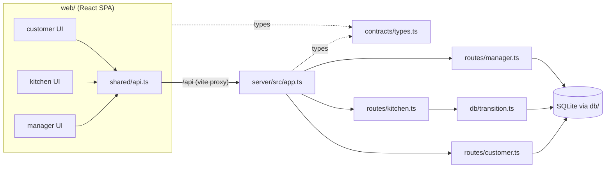
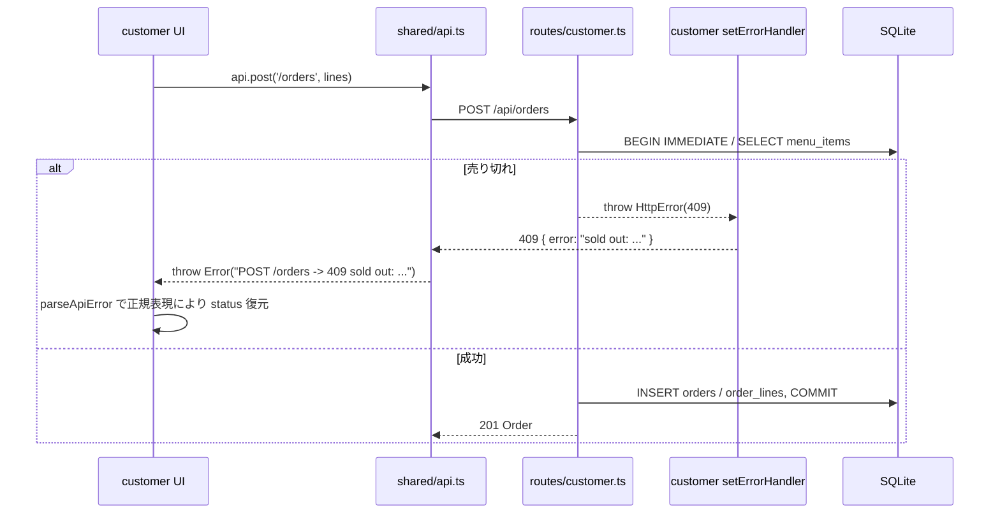
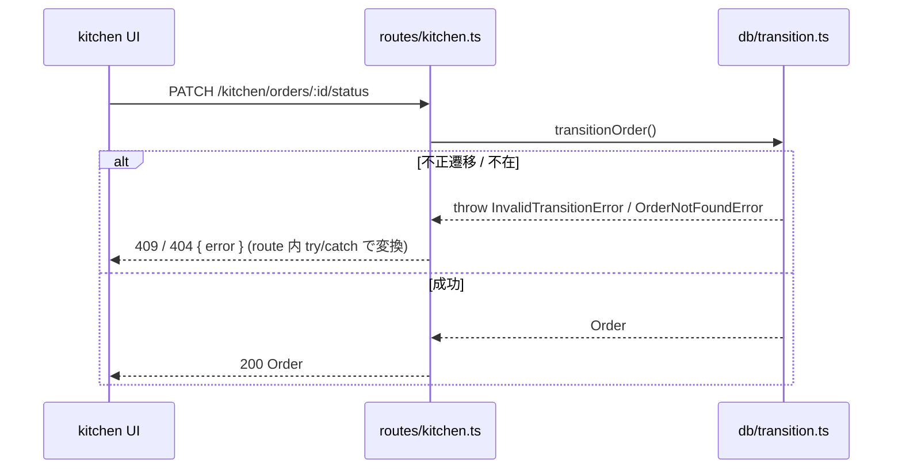

# Architecture

## Architecture Analysis

### System Overview
単一 npm パッケージ内に、Fastify API サーバー(`server/`)、React SPA(`web/`)、共有契約(`contracts/`)、E2E(`e2e/`)を同居させた構成。永続化は Node 組込み SQLite(`node:sqlite`)。

### Architectural Style
モジュラーモノリス。API は 3 つのユニット別 Fastify プラグイン(UA 客 / UB 厨房 / UC 店長)で、`server/src/app.ts` が登録するだけ。ユニット間の依存は `contracts/ownership.ts`(書き込み担当表・API 読み取り依存)で機械的に管理される。

### Component Relationships

テキスト代替: 3 つの UI は `web/src/shared/api.ts` を経由して `/api`(Vite プロキシ)で `app.ts` に到達し、`app.ts` は客・厨房・店長の 3 ルートプラグインを登録する。各ルートは SQLite へアクセスし、厨房は `db/transition.ts` 経由でのみ注文状態を更新する。web と server は `contracts/types.ts` の型を共有する。

### Data Flow
UI → `api.get/post/put/patch`(JSON)→ Fastify ルート → `db/queries.ts`(読み取り)または各ルートの SQL / `transitionOrder`(書き込み)→ JSON 応答。エラー応答は `{ "error": string }`(契約)。

### Key Design Decisions
- 書き込み担当をファイル単位で分離し、契約テスト 0b が静的検査(`contracts/ownership.ts`)
- `orders.status` / `completed_at` の更新は `db/transition.ts` のみ
- エラーハンドラは `app.ts` ではなく各プラグインのスコープ内で設定(Wave 1 の共通ファイル凍結の名残)。詳細は `code-quality-assessment.md`

### Improvement Opportunities
バックログ #11 / #12 の対象(共通エラー型・全体ハンドラ)。方針は `code-quality-assessment.md` の Handoff 項を参照。

## Interaction Diagrams

### 注文作成(409 売り切れエラーを含む)

テキスト代替: 客 UI が POST /orders を送る。ルートがトランザクション内で売り切れを検出すると `HttpError(409)` を投げ、客プラグインの `setErrorHandler` が `{ error }` に整形する。`api.ts` はそれを文字列メッセージの `Error` に変換し、UI が正規表現で status を復元して 409 分岐する。成功時は注文を INSERT して 201 を返す。

### 厨房のステータス更新(409/404 変換)

テキスト代替: 厨房ルートが `transitionOrder` を呼び、ドメインエラー 2 種を route 内の try/catch で 409/404 の `{ error }` に変換する。成功時は 200 と更新後の注文を返す。
