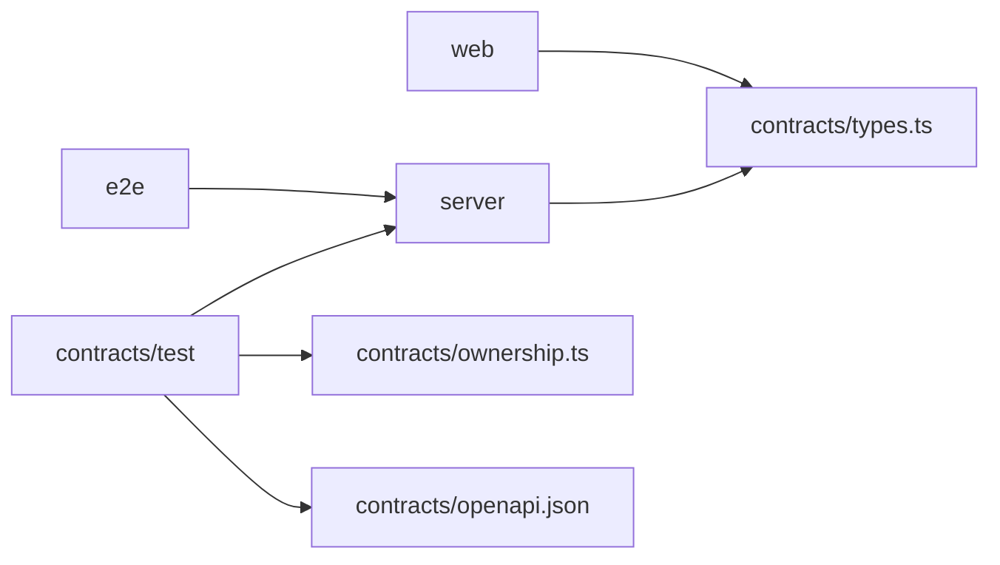

# Dependencies

## 外部依存
`technology-stack.md` の表を参照(本番: fastify, react, react-dom。他は devDependencies)。脆弱性・版数の監査は未実施(読み取りのみ)。

## 内部依存

テキスト代替: web と server は `contracts/types.ts` を import する。契約テストは server・ownership・openapi に依存し、E2E は server を別プロセスで起動する。

## 制約(本 intent に関係)
- `web/tsconfig.json` の `include` は `src` と `../contracts/types.ts` のみ。web が `contracts/` の新ファイルを import するには include の追加が必要
- web から `server/` は import 不可(別 tsconfig)。server と web が共有できるのは `contracts/` のみ
- 循環参照: 検出なし
