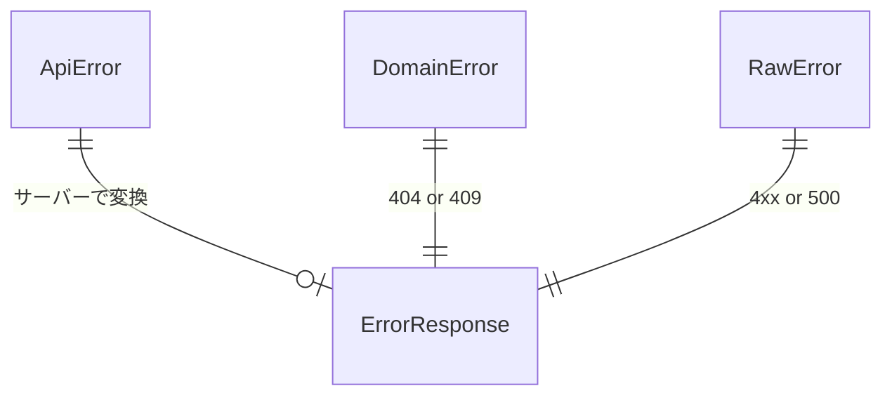
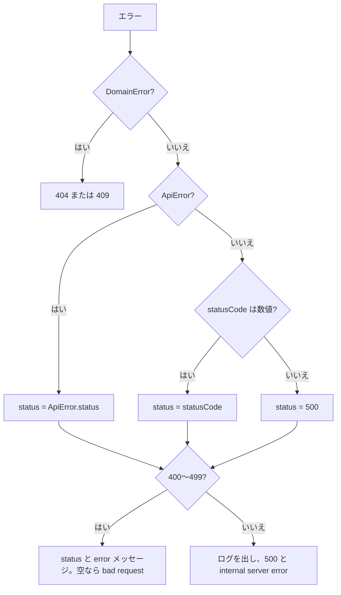

# Functional Spec: ApiError の共通化とエラーハンドラの集約

この文書は、エラーが起きたときの流れ(ワークフロー)と、変更前後の応答の違いを定めます。データの形は `entities.md`、判断のルールは `rules.md` が正本です。
入力は `requirements.md` と、現状のコード調査(`code-quality-assessment.md`、`architecture.md`、`code-structure.md`)です。この変更は、ユニットを分けない1つのまとまりとして扱います。
設計の前提と、質問 Q1〜Q4 の回答は `functional-design-questions.md` にあります。

## 1. ワークフロー

### W1. サーバーでエラーを応答にするまで

1. 客・厨房・店長のルートの処理中に、エラーが投げられる(`ApiError`、`DomainError`、または `RawError`)。
2. `app.ts` の全体ハンドラが受ける(BR2.5)。
3. `DomainError` なら、BR2.4 で 404 または 409 にする。
4. そうでなければ、BR2.1 の順で status を決める。
5. status が 400〜499 なら、その status と `{ error: メッセージ }` を返す。メッセージが空なら `"bad request"` にする(BR2.2)。
6. status が 400〜499 でなければ、`req.log.error` でログに出し、500 と `{ error: "internal server error" }` を返す(BR2.3)。
7. 存在しないルートの 404 そのものは、このワークフローを通らず、標準の形式のままにする(BR2.6)。
8. ただし、ルートの照合の前に起きる本文の解析エラー(壊れた JSON、非対応の content-type)の 4xx は、存在しないルートへのリクエストでも、この全体ハンドラが受ける。status はそのままで、本文は `{ error: メッセージ }` になる(BR2.7。受け入れ済みの変更)。

### W2. web で失敗を受け取るまで

1. 画面が API を呼び、応答が失敗する。
2. 共通の API 呼び出しが、応答本文の `error` を読む(読めなければ空にする)。
3. `ApiError`(`status`、`message`、`detail`)を作って投げる(BR1.2)。
4. 呼び出し元の画面が、BR3.1 または BR3.2 に従って判定・表示する。
5. 通信の失敗など、応答が無い場合は `ApiError` ではなく通常のエラーになる。客画面は status 無しとして扱う(BR3.1)。

### W3. 厨房での状態更新の失敗(404/409)

1. 厨房画面が、注文の状態更新を依頼する。
2. 状態遷移の処理が、`OrderNotFoundError` または `InvalidTransitionError` を投げる。
3. 厨房ルートは捕まえず、全体ハンドラが 404/409 にする(BR2.4)。
4. web が `ApiError` を作り、厨房画面が `"#<呼出番号> を更新できませんでした: " + String(e)` を表示する(BR3.2)。表示は現状と同じ。

## 2. 変更前後の応答の違い

下の表にない応答は、変更前後で同じです(NFR1)。実際に試した結果(Fastify 5)と、コードの確認に基づく一覧です。

| 場面 | 変更前 | 変更後 | 出典 |
|---|---|---|---|
| **存在しないルートに、壊れた JSON の本文(400)や非対応の content-type(415)を送る** | Fastify 標準の `{ statusCode, code, error, message }`。status は 400/415 | status は同じ。本文は `{ error: メッセージ }` | R-01。利用者が意図した変更として受け入れた。**応答の形(本文の構造)が変わる唯一の変更** |
| 客ルートで、Fastify 内部が返す 500 以外の 5xx(例: 503) | その status のまま、本文は `internal server error` | 500、本文は `internal server error` | 要件 Q3: A |
| 客・店長ルートで、メッセージが未定義または空の 4xx | 客・店長: 空のメッセージ | `"bad request"` | Q2 の回答 A |
| 厨房ルートで、メッセージが空文字列の 4xx(未定義の場合は、現状も `"bad request"` で変わらない) | 空文字列のまま(`e.message ?? 'bad request'` は空文字列を通す。`kitchen.ts:26`) | `"bad request"` | Q2 の回答 A、R-03 |
| 5xx のときのログ | 客・店長は `app.log.error`、厨房は `req.log.error` | すべて `req.log.error` | 要件 Q3: A |

ログの出し方の違いは、応答には出ません。

NFR1 は「例外は 503 のみ」と書いていましたが、上の表のとおり、受け入れ済みの変更は他にもあります。表のほうが正で、NFR1 の例外は、この表に挙げた4件に読み替えます(`requirements.md` の NFR1 は承認済みのため、ここに記録します)。

新しい動きを固定するテスト(BR4.6)は、表の1行目を対象にします。

## 3. 状態の遷移

この変更には、状態を持つデータはありません。注文の状態遷移(`PLACED → COOKING → READY`)は変えません。

## 4. 検証の進め方

1. 変更前に `npm test` を実行し、記録する(BR4.1)。
2. web 側のテストを先に追加し、変更前のコードで通ることを確認する(BR4.2)。置き場は `web/test/`、実行は `npm run test:web` で、`npm test` に含める(BR4.5)。
3. `contracts/` に `ApiError` を追加し、サーバーと web を置き換え、全体ハンドラを入れる。
4. 存在しないルートへの壊れた JSON と非対応の content-type について、新しい動きを固定するテストを追加する(BR4.6、`server/test/` 配下の新しいファイル)。
5. `npm test` と `npm run typecheck` を実行し、既存テストが書き換えなしで通ることを確認する(BR4.3、NFR2、NFR3)。`npm run typecheck` が web のテストの型で落ちる場合は、BR4.5 の対処(専用の tsconfig)を行う。
6. `setErrorHandler` が `server/src` に1か所だけ、`ApiError` の定義が1か所だけであることを `grep` で確認する(NFR4)。
7. 子プラグインがエラーハンドラを引き継ぐ前提は、レビューで Fastify 5 を使って確認済み。さらに、3 つのプラグインのエラー応答が、既存テストで変更前と同じであることでも確認する。

## 5. 派生した図

### エラーの形(`entities.md` から派生)

テキスト代替: `ApiError` は、サーバーで `ErrorResponse` に変換される。`DomainError` は 404 か 409 の `ErrorResponse` になる。`RawError` は 4xx か 500 の `ErrorResponse` になる。

### サーバーのエラー処理の流れ

テキスト代替: エラーは、まず `DomainError` かを調べ、そうなら 404/409 にする。そうでなければ `ApiError` の status、数値の statusCode、500 の順で status を決める。status が 400〜499 ならそのまま返し(メッセージが空なら `bad request`)、そうでなければログを出して 500 の `internal server error` を返す。

### ルールの要約(`rules.md` から派生)

| ルール | 内容 |
|---|---|
| BR1.1〜BR1.4 | `ApiError` の形、web での作り方、サーバーでの置き換え、DomainError は派生にしない |
| BR2.1〜BR2.7 | status の決め方、4xx と 4xx 以外の応答、DomainError の変換、全体ハンドラの登録、存在しないルートの 404、本文の解析エラーの形(受け入れ済みの変更) |
| BR3.1、BR3.2 | 客画面の判定、厨房・店長画面の文言 |
| BR4.1〜BR4.6 | 変更前のテスト、先に固定するテスト、既存テスト、契約テスト 0b、web テストの置き場所と実行方法、受け入れた動作変更を固定するテスト |

## Assumptions & Open Questions

None.
