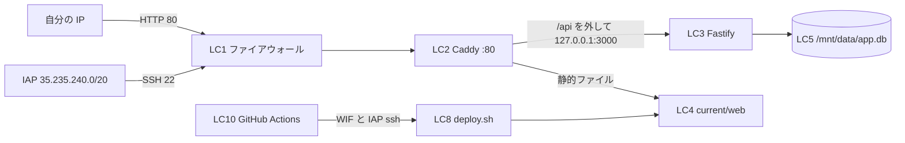

# 論理コンポーネント: mobile-order の Google Cloud デプロイ

## Sources

- `[Q1]` Caddy、`[Q2]` releases と current のリンク、`[Q3]` esbuild、`[Q4]` マウントの起動条件。`nfr-design-questions.md` の人間の回答
- `[memory:M1]` NFR 要件 5 文書と `tech-stack-decisions.md`(NFR1〜NFR7)
- `project.md` の ALWAYS / NEVER ルール(キーなし、WIF、自分の IP のみ、課金の承認)

## 方針

VM 1 台、ゾーン 1 つ。部品は「ビルドの経路(GitHub Actions のランナー)」「実行の経路(VM)」「状態(データディスク)」「統制(Terraform と WIF)」の 4 つの領域に分ける。障害の単位(failure domain)は VM 全体と、データディスク、ランナーの 3 つ。

## コンポーネントの一覧

| ID | コンポーネント | 置き場所 | 役割 | 適用する NFR |
|---|---|---|---|---|
| LC1 | ファイアウォール(VPC) | GCP | 80 番を自分の IP(CIDR)だけ、22 番を IAP の範囲 `35.235.240.0/20` だけから許可 | NFR2.1〜2.3 |
| LC2 | Caddy(`caddy.service`) | VM | `:80` で受け、`/api` を外して `127.0.0.1:3000` に転送し、画面の静的ファイル(`current/web`)を配信 | NFR5.8、NFR2.3 |
| LC3 | Fastify(`mobile-order.service`) | VM | `node current/server.mjs`。`HOST=127.0.0.1`、`PORT=3000`、`DB_PATH=/mnt/data/app.db` | NFR2.12、NFR3.1、NFR3.8 |
| LC4 | リリース置き場 | VM(ブートディスク) | `/opt/mobile-order/releases/<id>/`(`server.mjs`、`web/`)と、`current` のシンボリックリンク。直前の 1 世代だけ残す | NFR3.3、NFR5.3 |
| LC5 | データディスクと SQLite | 永続ディスク(別リソース) | `/mnt/data`(fstab で `nofail`)。DB は `/mnt/data/app.db`。`prevent_destroy` で保護 | NFR3.6、NFR3.8、NFR4.4 |
| LC6 | スワップファイル | VM(ブートディスク) | 1 GB。`vm.swappiness=10`。fstab で永続化 | NFR5.1、NFR5.2 |
| LC7 | journald | VM | 7 日・200 MB。アプリと Caddy のログを集める | NFR6.1、NFR6.2 |
| LC8 | デプロイスクリプト(`deploy.sh`) | VM(起動スクリプトで配置) | 成果物の受け取り、リンク切り替え、再起動、スモークテスト、ロールバック、メモリの記録 | NFR3.3、NFR5.3、NFR5.5 |
| LC9 | 起動スクリプト(provisioning) | VM | 冪等。Node.js のチェックサム検証つきの導入(`/opt/node-v<版>/` に展開し `/usr/local/bin/node` にリンク)、Caddy、`jq`、swap、fstab、systemd ユニット、journald 設定の配置 | NFR7.1、NFR7.2、NFR4.3 |
| LC10 | ビルドジョブ(GitHub Actions) | ランナー | Vite と esbuild でビルドし、成果物を IAP 経由で VM に転送。PR では認証しない | NFR5.3、NFR5.4、NFR2.5 |
| LC11 | WIF とデプロイ用サービスアカウント | GCP | `main` ブランチだけを許可。IAP、OS Login、VM のサービスアカウント利用の権限だけ | NFR2.4〜2.6 |
| LC12 | Terraform と state バケット | GCP / 手元 | 全リソースの定義。state は GCS。`apply` は人間の承認後に手動 | NFR2.9、NFR4.2、NFR1.x |

## インフラ設計に回すもの

- Caddyfile の具体例(`root` は `current/web`、`handle_path /api/*` で `127.0.0.1:3000` に転送、キャッシュヘッダ、`current` のシンボリックリンクが再起動なしで効くことの確認)は、Infrastructure Design で作成する。
- ESM バンドルの動作確認は、Infrastructure Design かウォーキングスケルトンで行う。動かない場合の代替案(`--format=cjs`)は `performance-design.md` に記載した。

## 構成図

テキストでの代替: 自分の IP から 80 番で LC1 を通って Caddy に入る。Caddy は画面を `current/web` から配信し、`/api` だけを `127.0.0.1:3000` の Fastify に渡す。Fastify は `/mnt/data/app.db` を読み書きする。デプロイは、ランナーが WIF で認証し、IAP 経由の SSH で `deploy.sh` を実行して `current` を切り替える。

## 障害の単位と影響範囲

| 障害 | 影響 | 復旧 |
|---|---|---|
| Fastify のプロセスが落ちる | `/api` が止まり、画面の静的配信は続く | systemd が 30 秒以内に再起動(NFR3.1) |
| Caddy が落ちる | 画面も API も止まる | systemd が再起動 |
| デプロイした版が壊れている | スモークテストが不合格 | `current` を直前の版に戻す(120 秒以内。NFR3.3) |
| データディスクが未マウント | アプリは起動しない(失敗として検知) | 手順書で原因を確認し、マウントしてから起動 |
| VM を作り直す | LC1〜LC4、LC6〜LC9 は作り直し | データディスクを付け直す。注文は残る(NFR3.6) |
| ゾーンの障害 | すべて止まる | 受け入れたリスク(NFR 要件) |

## 共有する資源

- メモリ 1 GB を、Caddy、Fastify(Node.js)、OS、スワップで分け合う(`performance-design.md` に予算)。
- ブートディスクにリリースと swap を置き、データディスクには DB だけを置く。ディスクを分けることで、VM の作り直しがデータに及ばない。

## Assumptions & Open Questions

- `[assumption]` A1: ブートディスクは 10 GB、データディスクは 10 GB 程度で、合計 30 GB 以内に収まる。具体的な大きさはインフラ設計で決める。
- 未確定: デプロイ用サービスアカウントが `gcloud compute ssh` で VM を引くための権限(`compute.instances.get` など)を、どのロールまたはカスタムロールで満たすか(NFR2.6 の範囲を保つ)は、インフラ設計で決める。
